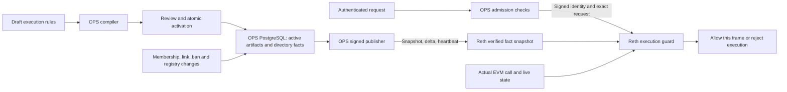
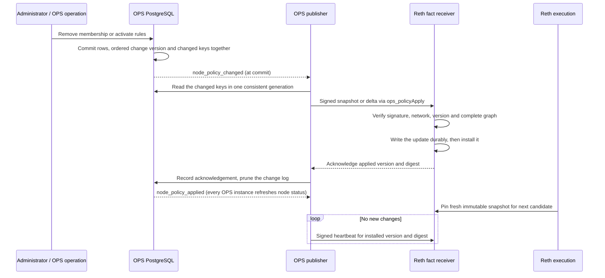
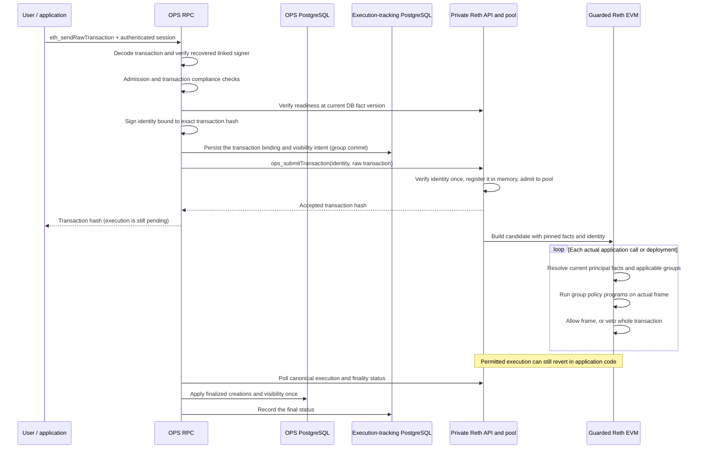
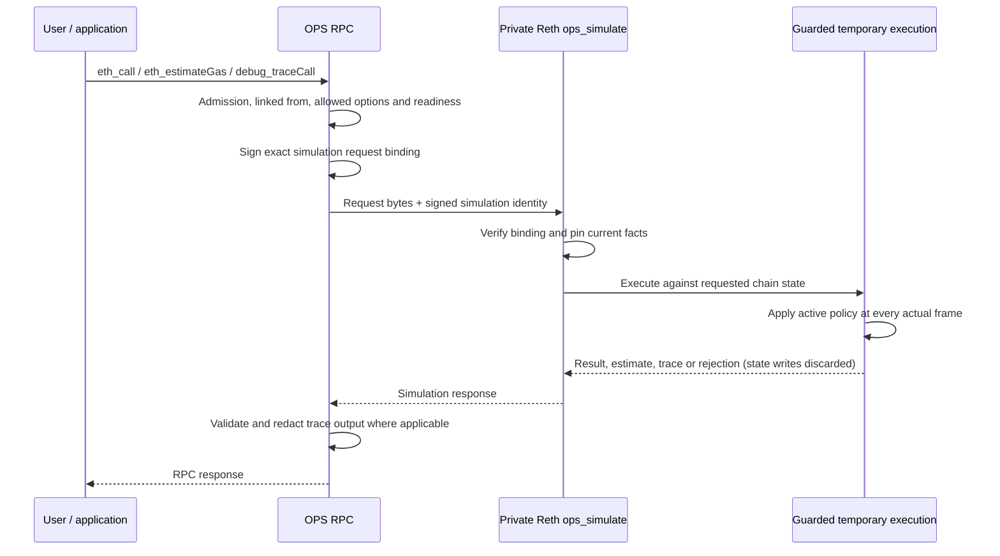
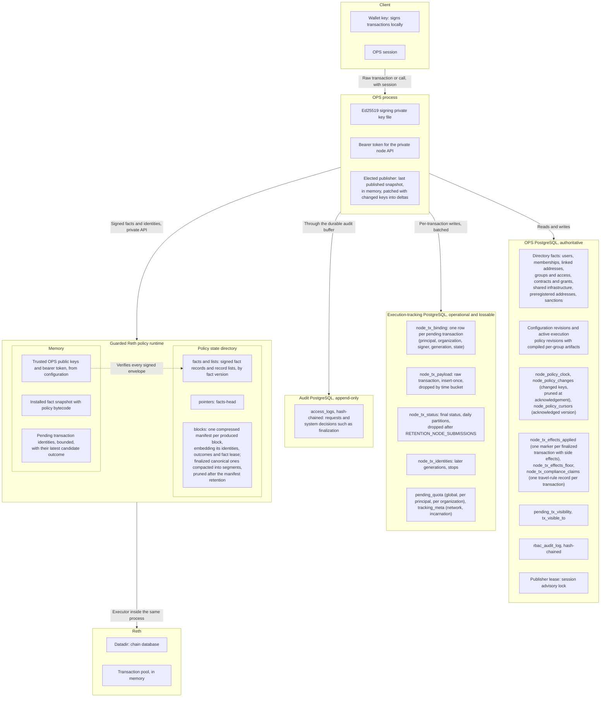

# How OPS v2 authorizes Reth execution

This walkthrough describes `OPS_NODE_POLICY_MODE=reth`: the V2 DSL compiler,
signed fact feed and guarded Reth runtime. OPS authenticates and admits the
request. Reth checks execution as each application call or deployment actually
runs, using approved policy code and an immutable snapshot of signed facts.

The detailed wire contract is in [Execution identity and facts](execution-context.md).
The [operator guide](../../site/src/app/docs/node-policy/page.mdx) covers setup,
configuration review and current limits; the
[stack runbook](../implementation/ops-reth-stack.md) reproduces the workflow.

## What replaces preflight

V1 signed approvals use a prepared preflight trace that OPS authorizes before
issuing an approval. V2 selects a separate request path: OPS sends an identity
bound to the exact request, and Reth evaluates the actual execution frames.
A preview can help an author or caller, but it grants no authority to execute
later. State, memberships or policies may change before a transaction executes.

Merely disabling a tracing/preflight option does **not** enable this behavior.
V2 requires `OPS_NODE_POLICY_MODE=reth`, a matching guarded Reth build, the
private endpoint and signing trust. OPS refuses startup if V1
`OPS_APPROVAL_TARGETS` is also configured. A failed V2 request never falls back
to the legacy authorization path.

## The inputs to a decision

There are four distinct inputs. Changing membership does not require compiling
a new Solidity program.

| Input | Authority and contents | How Reth receives it |
| --- | --- | --- |
| Execution rules | An approved organization document binds groups to allowed calls, targets and argument conditions. OPS compiles one program per group. | Active bytecode, revision and digests in the signed fact feed. |
| Directory facts | OPS PostgreSQL holds users, linked addresses, memberships and expiry, groups and organizations, operational claims, contract ownership, shared infrastructure and sanctions. | A signed versioned snapshot, then atomic deltas and freshness heartbeats. |
| Request identity | OPS establishes the authenticated principal, selected organization and linked Ethereum signer. | A short-lived signed envelope bound to the exact transaction or simulation. It contains neither memberships nor an allow verdict. |
| Actual call and chain state | Reth observes the executing code/storage addresses, caller, selector, calldata, value and depth; contract state comes from its EVM. | Constructed locally at the execution boundary. Approved record getters can read live execution state. |



OPS remains responsible for authentication, current user ban/KYC checks,
organization selection and membership, RPC method admission, linked-sender
verification and request limits. Configured transaction compliance checks also
run before submission. Reth independently resolves the signed principal's
current links, membership expiry, bans, sanctions and organization/claim facts
when authorizing execution. The exported KYC field does not replace OPS's KYC
gate with a Solidity rule; transaction compliance is also not rerun as policy
bytecode.

## How the policy programs are generated

1. An author prepares an `execution-rules` configuration document. Its
   `ContractExecutionPolicy` names the organization and group bindings. Rules
   name contract addresses or supported target classes, function selectors,
   permitted call types and optional constraints. Examples include an address
   argument matching the signer or one of the principal's linked addresses,
   an integer argument ceiling, native value, call depth, immediate caller,
   deployment/upgrade authority and a `recordParty` condition.
2. OPS validates the document against the group's organization and registered
   contract ABIs. Exact selectors pin the ABI digest used to interpret their
   arguments. Explicit sibling configuration revisions can provide the
   catalog for a coordinated change; dependencies are checked again at activation.
3. The generator emits Solidity containing dispatch and condition checks. The
   pinned **solc 0.8.35** compiles it with the recorded optimizer/EVM settings.
   Each bound group gets an artifact containing generated source, runtime
   bytecode, hashes, compiler settings and the whole-document policy digest.
4. Review covers the complete set and its exact contents. A separate authorized
   approver activates the organization revision atomically. The standard human
   flow uses independent author/reviewer identities; configured trusted-CI
   approval has its own exact-revision proof requirements.
5. The publisher sends active artifacts with the facts. Reth receives compiled
   bytes; it does not run solc for each request. Removing a binding removes its
   published artifact. A draft or ordinary preview does not change active rules.

Existing RBAC execution grants can seed an imported baseline. That baseline
still goes through compilation, review and activation. Once execution rules are
managed this way, a read grant is not by itself a new execution allowance.

Conceptually, one group's program can say: “Allow this registered contract's
`transfer(address,uint256)` when the recipient is linked to the current
principal and the amount is at most the configured ceiling.” The program
contains the contract/selector and ceiling. Reth supplies the current linked
addresses and the actual calldata. User IDs and changing membership lists are
not baked into newly generated code for each request.

The runtime entry point is `check(Facts, Call)`. The guard constructs those
arguments itself, including the principal's current groups and target-specific
claims, ownership/classification facts and the actual call. The program returns
an allow/denial reason. A `recordParty` condition additionally calls its
ABI-pinned getter against live state, inside the policy's guarded organization
scope. It can therefore change its answer after on-chain data changes without
a membership edit or policy recompile.

Event visibility rules and disclosure grants remain part of OPS's read/privacy
system. They do not become execution rules merely because they appear in the
same registered ABI or configuration workflow.

## How changing facts reach Reth

PostgreSQL remains authoritative. A change to a column the fact export reads
(the dependency set in `node_policy_export.go`) advances one commit-ordered
version, once per database transaction, and records the changed keys
(principal, DID, group, contract, organisation policy, sanction) in a change
log, in that same transaction. Changes to anything else (names, notes,
metadata, login timestamps) do not move the version.

Publication is event driven. The transaction that advances the version sends
`node_policy_changed` at commit; the elected publisher listens on its own
database session and publishes at once. Notifications that arrive while it is
publishing collapse into one more publication. The one-second publication
interval remains as the heartbeat and the fallback when the subscription is
lost; a resubscription publishes at once, because changes may have been
missed meanwhile. The publisher exports only the keys changed since the
generation the node acknowledged, in one consistent database snapshot,
including active policy artifacts. It reads every fact again when the change
log cannot describe the gap (it was pruned past that generation, a fact table
was truncated, or the change is large), when the incremental read fails, at
every checkpoint, after a publisher restart or failover (it cannot know how
the node's facts were built), and at least every five minutes, when it also
compares the incrementally published facts with a full export and republishes
in full on any difference. The change log is written only through
security-definer functions, so the runtime role can add keys or prune through
an acknowledged version but cannot remove a change unseen; without a
publisher it keeps the last 8,192 versions. It sends a full snapshot
to bootstrap or resynchronize, otherwise a delta containing upserts and
explicit deletions. Each envelope is signed with the OPS Ed25519 key and bound
to the chain and deployment. Reth verifies it using configured public keys over
a separate authenticated private endpoint. Recording the node's acknowledgement
prunes the change log through that version and sends `node_policy_applied`,
which makes every OPS instance re-read the node's status at once instead of at
its next one-second check.



Defaults are a **one-second heartbeat interval**, **30-second fact freshness
lease**, a **one-minute simulation identity lifetime** and a **five-minute
transaction identity lifetime** (renewed while pending, see below). A heartbeat renews freshness; it
does not change facts. Missing versions require resynchronization. Invalid,
missing or expired facts prevent new execution.

Before minting a request identity, OPS reads the current database version and
the database clock in one statement; the version becomes the identity's minimum
required snapshot version, so a revocation committed before the request always
binds it, and the clock is the issue time, so identities from every OPS
instance are ordered by one clock. A later identity for the same transaction
replaces the stored one only if it dominates it (floor and expiry both at
least as high); an earlier one is still sent, and the node answers it as a
duplicate. Readiness comes from a cached
node status (refreshed every second and on every acknowledgement), not a node
call per request. If the node is ready but has not applied that version yet,
OPS hands the request on when the node advertises `fact_wait_v1`: the node
holds the request, without a worker, until publication brings that version or
its bounded wait ends (default one second, at most 32 requests at once), then
admits it or answers -32012, which OPS returns as 503 with `Retry-After: 1` and
reason `publication_pending`; stale or missing facts are refused at once. OPS
refuses the same way itself once it has seen the node behind for longer than
that wait, or at once for a node without the capability. A configuration being
active in PostgreSQL and applied on Reth are separate states, exposed by
publication/readiness status.

A candidate block pins one coherent snapshot; it never adopts half a policy
set or changes memberships halfway through execution. A revocation affects
subsequent candidates once published. An already pinned candidate can still
finish under its snapshot. Self-import and replay of unfinalized blocks use the
retained signed evidence of the original execution (a block this node has just
produced and published imports once from the verified execution it recorded,
without reading it back); finalized history the node
already holds re-executes without it; ordinary user queries use current
permissions.

## A signed transaction, step by step



The signed identity names the **OPS principal**, organization, Ethereum signer,
scope, request hash, context ID, network, expiry and minimum fact version.
Several OPS principals can share one Ethereum signer and still have different
permissions. Reth does not guess the principal from the address. OPS's durable
submission record binds the transaction hash to one principal before anything
reaches the node, and the node refuses another principal while the identity's
lease is valid.

At each CALL, STATICCALL, DELEGATECALL, CALLCODE, CREATE or CREATE2 boundary,
the guard observes the real frame. Code and storage addresses are separate,
which matters for proxies and delegated calls. It determines the relevant
policy organization (normally the storage owner; the selected organization for
creation), checks current facts and selects that principal's applicable group
artifacts in sorted group-ID order. One allowing group can authorize the frame;
no matching permission, invalid output, failed policy execution or exhausted
budget denies it. Nested calls need their own permission.

Policy code executes privately in an isolated EVM frame. Its temporary state,
gas accounting, access warming and trace frames do not become application
effects. An inner denial vetoes the **whole transaction**, even if a contract
catches the inner revert. That denied attempt's state is not committed to the
block. Ordinary application reverts remain possible after policy authorization.

Pool acceptance is not permission or finality. A denied pending transaction may
be reconsidered if facts change while its identity remains valid. A current
denial or expired identity also does not cancel a candidate already executing.
OPS distinguishes these states from canonical inclusion, finality and completed
bookkeeping, and keeps a pending transaction deliverable itself (next section).

## Renewal and recovery

The node keeps pending identities in memory only, so a node restart, a lost
pool entry or a lapsing identity would leave a pending transaction unable to
execute. The elected OPS instance runs one lease keeper, sharing the
reconciler's in-memory schedule, that renews such a transaction.

```mermaid
sequenceDiagram
    participant Rec as Reconciler (elected OPS)
    participant Keep as Lease keeper (same term)
    participant TDB as Execution-tracking PostgreSQL
    participant DB as OPS PostgreSQL
    participant AUD as Durable audit buffer
    participant Node as Private Reth API and pool
    participant Pub as Node public RPC (NODE_URL)
    Rec->>Node: Status polls (batched where the node supports it)
    Node-->>Rec: Outcome, boot id, finalized head, pool flag
    Rec->>Pub: Still in the pool? (when the node reports no pool flag)
    Rec->>Keep: Candidates: undelivered for this boot, boot changed, evicted, lease ending
    Keep->>TDB: Re-read the candidates (delivery, claim, generation)
    Keep->>DB: Full admission re-check, compliance renewal mode
    Keep->>DB: Fact version and database clock (after every re-check)
    Keep->>Keep: Sign: same principal, organization, signer, hash; lease capped at the maximum age
    Keep->>AUD: ops.system.recovery / identity_renewal / renewal_refused / renewal_stopped
    Keep->>TDB: New generation + history row + delivery claim (fenced by generation and context)
    Keep->>Node: ops_submitTransaction on the recovery lane
    Node-->>Keep: accepted + boot id, or -32013 (nonce_used / replaced)
    Keep->>TDB: Acknowledgement against the answering boot (batched), or stop
```

- **Triggers.** A pending binding is renewed when its current generation is not
  acknowledged by the node's current boot and no unexpired delivery claim for
  that boot holds it (an OPS crash between recording and sending, a failed
  send, a node restart), when the node's pool no longer holds it while its
  identity is still registered (same-boot eviction), or when its lease has at
  most half of the transaction identity lifetime left and a renewal would
  extend it (congestion). A reorg back to pending keeps the delivery record of
  the boot that observed the inclusion: that node process holds the identity
  until finality.
- **Budget and limits.** Renewals of every trigger are spent within the
  renewal budget, earliest expiry first; re-checks start only in the first two
  seconds of a tick, each bounded on its own, so a slow checker defers
  renewals instead of stalling reconciliation. Admission keeps the pending
  work within what the budget can renew in time: a global limit (budget ×
  lifetime / 4 minus a reorg's worth of blocks) and per-principal and
  per-organization limits, all counted per state transition in the tracking
  database (`pending_quota`, `pending_quota_principal`, `pending_quota_org`)
  in the batch that changes the binding. Retries of a recorded transaction and reorgs back to pending are
  never refused.
- **Delivery claims and acknowledgements.** Recording an intent claims the row
  for the delivering instance and node boot for 20 seconds; the keeper honours
  any claim for the current boot, its own included, and a claim is void once
  the boot changes. An acknowledgement is recorded against the boot id of the
  node response that carried it, and only for the generation it delivered.
- **Decisions.** Every renewal re-runs the full admission check and compliance
  in renewal mode (only the travel-rule record bound to this transaction counts)
  before signing at the current fact version. A refusal, the maximum age, or a
  pool refusal stops renewal (`renewal_stopped`, not final). Every decision is
  appended to the durable audit buffer before it is recorded, and recorded
  before the identity is sent. A failed send of a recorded generation is
  retried unchanged while the node keeps its boot.
- **Final failure.** `dropped` is written only for a stopped binding whose
  signer's nonce at the finalized block has passed its own nonce with no own
  receipt, on two reads at least 30 seconds apart. A node with
  `transaction_statuses_v1` answers both in the batched status call, at its own
  finalized block; otherwise OPS reads them from the public RPC by the
  node-reported finalized block's hash and confirms with a definitive private
  status answer. A lookup the node could not answer is never evidence. Lease expiry alone never
  makes a transaction final, and a finalized own receipt beats a stop.
- **Option A reconciliation.** Where the node advertises
  `transaction_statuses_v1`, the reconciler polls up to 256 transactions per
  call and up to 16,384 per tick; a change of the node's canonical epoch
  re-polls every provisional row, and an entry the node could not answer is
  polled again. Otherwise it polls one transaction per call, up to 4,096 per
  tick.

## What happens for an RPC call

`eth_call`, `eth_estimateGas` and `debug_traceCall` execute application code, so
they use the guarded simulation path. They do not require an Ethereum-signed
transaction: OPS authenticates the caller and signs the simulation context.
The `from` address must be linked to that principal; OPS can fill it only when
there is exactly one linked address.



The binding covers the exact method, parameters, block reference and candidate/
diagnostic flags. Each simulation has its own context, so concurrent requests
cannot inherit another principal's identity. Gas estimation can execute several
attempts, each subject to the guard. A historical block reference selects
historical chain state with **current access permissions**. State/code/storage
and block overrides are refused. These simulations do not run the transaction-
only compliance checks; OPS admission and Reth execution authorization still
apply.

| RPC category in V2 mode | Handling |
| --- | --- |
| `eth_sendRawTransaction` | Signed transaction identity, pool admission and guarded actual execution. |
| `eth_call`, `eth_estimateGas`, `debug_traceCall` | Signed private simulation using the active execution policy. Public trace responses use vetted `callTracer` output with OPS privacy filtering. |
| Logs, receipts, transaction/block reads, storage reads and metadata | Existing OPS method/access gates and applicable response/visibility filters. These are not all policy-program executions. |
| `eth_sendTransaction`, `eth_createAccessList`, `debug_traceTransaction` | Explicitly unavailable in the current V2 path; no fallback to unguarded execution. |

Saved candidate revision previews are separate from ordinary RPC and can use
draft or active revisions without a prior review. A candidate can
report what its rules would decide, while active permissions still authorize
ordinary execution. Ordinary candidate previews cannot perform live record or
account reads, even when previewing an active revision; candidates with
`recordParty` require explicit, audited human-admin diagnostics. Those diagnostics
can evaluate broader candidates within an independent organization boundary;
strict read privacy refuses diagnostic call/estimate output and exposes only
the permission verdict for diagnostic traces. Preview never activates a policy.

## Where state lives

OPS PostgreSQL is the authority for people, organizations, contracts and
configuration. Per-transaction execution state — who submitted each pending
transaction, its delivery and inclusion, and the final status kept for owner
lookups — lives in a separate execution-tracking database, so no
per-transaction write stream reaches the main database. Losing the tracking
database loses only in-flight follow-up, never configuration, identity or
audit. The node keeps two kinds of state: what it needs to execute now
(memory) and the signed evidence it needs to prove or replay past execution
(its policy state directory). Keys stay with their owners: the client keeps the
wallet key, OPS keeps the signing key, and the node holds only OPS public keys.



Every snapshot and delta is written durably, with the record list it completes
and the `facts-head` pointer, before the node installs it, so a restarted node
resumes the same fact chain and a block never references unwritten facts. A
heartbeat is not written: each block's manifest embeds the heartbeat that made
its facts fresh. After a restart the node is ready while the latest record's own
lease is valid, or again at the publisher's next heartbeat. The state directory
carries a layout marker and is locked by the one node process using it; a
directory in an older layout is refused. A block's manifest is compacted into a
segment of finalized canonical blocks once the block is final and written;
other builds of a final height are removed; segments older than the manifest
retention are deleted with the fact records only they used, on the node's
maintenance thread. A pending transaction identity lives
only in the node's memory, from
admission until the transaction's canonical block is final and written by Reth
(the node releases it itself; OPS's status poll does too) or its lease expires
and a later admission reclaims it; admission does no storage I/O. The node
reports finality only up to the height Reth has written, so a crash never loses
a block reported final. A
restarted node holds no pending identities: a transaction not yet included
cannot execute until OPS renews it. OPS sees the new `boot_id`, re-checks the
principal's admission at the current facts and redelivers every pending
transaction with no client action; its binding row in the execution-tracking
database keeps the principal binding meanwhile. Each process start has a new random `boot_id`, kept in memory only;
every successful status, fact-apply and submission result names it. A
definitive pool rejection of the transaction's bytes (its nonce is used without
its own receipt, or a replacement is underpriced) undoes exactly that
registration. The transaction pool itself is Reth's in-memory pool. Reth saves
local pool transactions only on graceful shutdown and restores them at start, so
a crash loses pooled transactions while OPS keeps their binding rows and raw
transactions and redelivers them. The
node accepts a resend even when the transaction is still pooled. A block's
manifest, published once before the block is returned, embeds the
signed identity and outcome of every transaction in the block and names the
facts it was built on; self-import, forensic replay and the status of included
transactions read it, ordinary queries do not.

The next diagram follows the records of one transaction across these stores.

```mermaid
sequenceDiagram
    participant OPS as OPS process
    participant DB as OPS PostgreSQL
    participant TDB as Execution-tracking PostgreSQL
    participant AUD as Durable audit buffer
    participant RT as Node runtime memory
    participant Dir as Node policy state directory
    participant Reth as Reth pool and chain
    OPS->>DB: Read current fact version
    OPS->>OPS: Sign identity bound to the transaction hash
    OPS->>TDB: Insert binding and payload rows, pending (one commit per batch of requests)
    OPS->>RT: ops_submitTransaction(identity, raw transaction)
    RT->>RT: Register pending identity, memory only
    RT->>Reth: Insert raw transaction into pool
    Note over OPS: The acceptance is kept in memory and written only<br/>if no later transition records it first
    Reth->>RT: Build candidate block with pinned facts
    RT->>RT: Candidate outcome (pending or denied), memory only
    RT->>Dir: One compressed block manifest: identities, outcomes, facts, lease
    Note over RT,Dir: The manifest is durable before the block is returned
    Reth->>Reth: Persist block in chain database
    Reth->>RT: Finalized and written: release the pending identity slot
    loop Reconciler until a final outcome
        OPS->>RT: ops_transactionStatus(hash)
        RT->>Reth: Canonical receipt and finalized head
        RT->>RT: Finality capped at the height Reth has written
        RT-->>OPS: included or reverted, finality, created contracts
        OPS->>TDB: Included, not final: mark provisional (batched; nothing for unchanged polls)
    end
    OPS->>AUD: ops.system.finalized event, before the decision commits
    Note over OPS,DB: With side effects: one main-database transaction, once per transaction (marker)
    OPS->>DB: Register created contracts and deploy grant
    OPS->>DB: Queue visibility in pending_tx_visibility
    OPS->>TDB: Delete the binding, insert the final status (batched)
    DB->>DB: Visibility reconciler promotes to tx_visible_to
```

Ownership and visibility are written only from finalized node evidence, in a
main-database transaction guarded by a per-transaction marker, so a crash
before the tracking database records the final status re-runs it without
applying anything twice; the marker's effect bits also keep a grant an
administrator revoked from coming back. Transactions without side effects
write nothing to the main database. A newly
registered contract is itself a fact change: it advances the fact version, so
the next publication carries its ownership to the node. Until finality, an
included outcome stays provisional and can return to pending after a reorg.

## Capacity and trust boundaries

- Each group's runtime bytecode must fit **24,576 bytes**. Separate artifacts
  remove the old organization-wide code-size bottleneck; a large individual
  group can still be rejected. There is no automatic split within a group.
- All group evaluations for one application frame share **100,000 policy gas**.
  More memberships can exhaust that budget before an allowing rule is reached.
  The measured 11/12-membership boundary is workload-specific, not a supported
  universal count. See [the accepted limitation](../OPEN_ITEMS.md#12-reth-per-group-permission-budget).
- The tested stack uses a local Reth producer. Production multi-validator
  consensus integration and distribution of replay evidence are separate work.
- A guarded node trusts its own finalized canonical history: a block at or below
  the finalized head on its canonical chain (checked by hash) re-executes its
  own transactions without policy and needs no manifest; any other block needs
  its manifest. Consensus validation applies either way. After a restart the
  finalized head is the canonical block at the persisted finalized height. This
  relies on finality from consensus the operator controls, and it removes the
  evidence re-check for finalized blocks: a change to a detective control that
  needs change-management review.
- Reth and the OPS signer are trusted components. Private policy programs and
  signed facts are visible to the node operator; this design does not provide
  operator blindness. Keep node data/private RPC away from end users and retain
  OPS's read/privacy boundary.

## Implementation reference

| Responsibility | Source |
| --- | --- |
| V2 dispatch and admission | [`jsonrpc_node_policy.go`](../../internal/server/jsonrpc_node_policy.go), [`admission.go`](../../internal/rbac/admission.go) |
| Identity readiness, signing and durable submission | [`node_policy.go`](../../internal/server/node_policy.go) |
| Policy schema and Solidity generation | [`policy.go`](../../internal/policydsl/policy.go), [`generate.go`](../../internal/policydsl/generate.go), [`compile.go`](../../internal/policydsl/compile.go) |
| Catalog validation, artifact review and activation | [`configuration_revision_execution.go`](../../internal/db/configuration_revision_execution.go) |
| Database facts and publication | [`node_policy_export.go`](../../internal/db/node_policy_export.go), [`publisher.go`](../../internal/nodepolicy/publisher.go) |
| Reth fact resolution and actual frame checks | [`facts.rs`](../../node/reth/src/facts.rs), [`policy.rs`](../../node/reth/src/policy.rs) |
| Reth identity retention, candidate pinning and replay | [`runtime.rs`](../../node/reth/src/runtime.rs) |
| Node evidence store (objects, pointers, block manifests) | [`archive.rs`](../../node/reth/src/archive.rs), [`stream.rs`](../../node/reth/src/stream.rs) |
| Submission records and outcome reconciliation | [`node_submission.go`](../../internal/db/node_submission.go), [`node_reconciler.go`](../../internal/server/node_reconciler.go) |
| Candidate/admin simulation privacy | [`node_simulation.go`](../../internal/server/node_simulation.go), [`simulation.rs`](../../node/reth/src/simulation.rs) |
