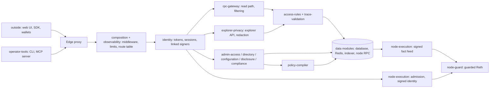

# Security perimeter

An external security audit covers a defined set of code. This document defines
the **security perimeter** of Open Privacy Suite (OPS): the code an audit of a
Reth-mode (V2) deployment has to cover. It also covers how CI keeps that
definition true as the code changes, and how to scope a full or partial audit.

Three files make up the perimeter map:

| File | Role |
| --- | --- |
| [`modules.toml`](modules.toml) | The map. Every source file belongs to exactly one module; each module has a tier, an owner and the reason for its tier. |
| [`perimeter-report.md`](perimeter-report.md) | Generated sizes per module, tier and audit scope. `make perimeter-report` regenerates it. |
| this document | What the tiers mean, what CI enforces and the trust assumptions an audit starts from. |

## Tiers

| Tier | Meaning | Audit |
| --- | --- | --- |
| `core` | Code linked into a shipped binary that can leak data or grant access in a Reth-mode deployment. | In scope. |
| `legacy` | Code that is security-critical only in the legacy or V1 signed-approval modes, which a Reth-mode deployment never selects: legacy paths linked into the server, and the V1 Besu and Reth plugins. | Reviewed for its effect on Reth mode (see "What the checks do not prove"), not audited, in a Reth-mode audit; in scope for a legacy-mode deployment. |
| `outside` | Code that is never linked into a shipped binary: the web UI, the TypeScript SDK, build and test tooling, demo contracts, and dev-only code compiled out of production builds. It reaches the system only through the network API. | Out of scope. |

**The audit boundary is the process boundary.** Go code linked into the
server binary runs with the same authority as the perimeter. It can change
process-wide state that no type-level rule confines: environment variables,
default HTTP clients, request objects in a middleware, package initialization.
A metrics middleware that rewrote the request's remote address would switch
off the private-network gate without naming any perimeter code. So nothing
linked into a shipped binary is `outside`. Shipped code that the V2 path does
not use is `legacy`: the rules below, together with a review, keep it from
running in Reth mode. To take code out of the perimeter for good, move it out
of the shipped binary, for example into a separate service or tool that talks
to the API.

Each core module also has an **audit scope**, so the perimeter can be audited
as a whole or in parts:

| Audit scope | Covers |
| --- | --- |
| `execution` | V2 execution authority: admission and signed identities, the signed fact feed, the policy compiler, reviewed configuration and the guarded Reth node. |
| `read` | Read privacy: the JSON-RPC read path and response filtering, RBAC rules, trace validation, the explorer API and redaction, disclosure grants. |
| `platform` | What every path relies on: startup and mode selection, routing and middleware, identity, admin authorization and impersonation, the directory (organizations, users, groups, contracts, grants), audit trail, schema, data access, metrics. |
| `compliance` | Sanctions, thresholds, travel-rule records and price feeds. |
| `operator-tools` | The operator CLI (deployment registration with a user token, break-glass database commands) and the MCP server, which acts with the admin token. |

An audit of one scope still needs the platform code that scope runs on.

## What CI enforces

`internal/archtest/perimeter_test.go` runs with the Go unit tests. It
type-checks every Go file of the server and the operator binaries
(`cmd/server`, `cmd/privacy-cli`, `cmd/migrate` and everything they link) with
the production build tag. It fails if any of those files was not analyzed,
and on any of the following.

| Rule | Why |
| --- | --- |
| A source file belongs to no module, or to several. A module marked `generated` contains a file whose leading comment does not mark it as generated by the module's declared generator. | New code has to be placed in the map, which decides whether an audit covers it. Generated code is not counted, so the flag has to be true. |
| A shipped file belongs to an `outside` module. | See "The audit boundary is the process boundary". |
| Core code names legacy-mode code (calls it, takes it as a value, constructs it) outside a declared `dispatch` function, or a dispatch function names a legacy object its entry does not list. Type declarations may name legacy types. A function literal does not share its enclosing function's entry. | Legacy code runs only where a dispatch point selects it, and each entry states the condition that keeps it out of Reth mode. A closure can run later, outside that condition. |
| Core code hands a legacy value (a legacy type or function) to a core field, variable, parameter or return value outside a dispatch function that lists it. | A legacy implementation behind a core interface would otherwise run from core code that never names it. |
| A hand-written legacy-mode file has an `init` or `main` function or a blank import, or a package-level initializer makes any call other than to an allowlisted constructor (error values, regular expressions, Redis scripts). | Initialization runs in every mode, before any dispatch point. |
| A hand-written legacy-mode file declares a method on a core type, and some interface in the program has a method of that name. | Core code could then run it through that interface in every mode, for example to decide which error text a client sees. |
| A dispatch entry names a function that does not exist, or lists an object the function no longer names. | A stale entry would silently allow future code. |
| `perimeter-report.md` does not match the core and legacy code. | The size figures stay current. Outside modules are listed without sizes, so UI and tooling changes do not touch the report. |

The checks work on identifiers resolved by the Go type checker. They follow
static references: function and method calls, promoted fields, method values,
generic instantiations, and values handed over by call, assignment, return,
`append` and channel send. They fail closed: a reference into an unclassified
file is a violation.

### What the checks do not prove

Legacy code is linked into the same binary as the perimeter. The checks catch
the usual ways it could run in Reth mode, but they cannot rule out every one.
Excluding the legacy tier from a Reth-mode audit therefore rests on a review
of the legacy code for the effects below, and the checks support that review
rather than replace it. A boundary that needs no such review requires the
legacy code to be compiled out of the Reth-mode build, or removed.

- **Calls through interfaces.** Interface calls are not followed to their
  implementations. The checks catch legacy values handed to core code and
  legacy methods added to core types under an interface's method name, but
  not every way a legacy method can end up behind an interface (for example
  a value converted on its way through a dependency).
- **Startup in dependencies.** Packages that only legacy code imports run
  their own initialization in every mode.
- **Implicit calls.** Formatting, logging and encoding call methods such as
  `String`, `Error` and `MarshalJSON` on the values they are given.
- **Each dispatch reason.** The condition an entry states (for example
  "returns before calling any V1 constructor in Reth mode") is verified by
  reading that function, and the functions and startup checks its reason
  names.
- **Code outside the shipped Go binaries.** The guarded Reth node (Rust), SQL
  and the MCP server (a separate Go module) are classified and measured, not
  type-checked here.
- **Behavior that depends on runtime configuration** rather than code
  structure.
- **Other build settings.** The checks use the host's operating system and
  cgo settings, not the image's (`linux`, cgo enabled); no shipped package
  has platform-specific files today. The boundary check is skipped under
  `go test -short`.

## Data paths through the perimeter



Every request enters through the route table and its middleware. Apart from
public endpoints (health and readiness, the login flows), identity
establishes the caller before any data module is reached. Execution in Reth
mode leaves OPS as a signed identity bound to the exact request; the guarded
node decides at every call frame using compiled policy and signed facts (see
[How OPS v2 authorizes Reth execution](reth-execution-flow.md)).

## How Reth mode keeps legacy code out

A Reth-mode deployment never takes a legacy request path:

- Startup refuses `OPS_NODE_POLICY_MODE=reth` together with V1 approval
  targets, and together with the cross-org authorization oracle.
- The V1 approval service is built only in `newNodeApprovals`, which returns
  before calling any V1 constructor in Reth mode.
- `JSONRPCProcessor.Process` hands every execution method (sends, calls,
  estimates, traces, access lists) to the node path before the legacy
  `eth_sendRawTransaction` path.
- The oracle's route is mounted behind a core middleware that answers 404
  unless the oracle is enabled.
- Apart from type declarations, the `dispatch` entries in `modules.toml` are
  the only places core code names legacy code. A Reth-mode audit reads those
  functions and reviews the legacy code for the effects listed under "What the
  checks do not prove". It does not audit the legacy modules' own logic.

Code that a Reth-mode deployment can still reach stays in the core tier even
when it was written for the legacy path. For example, the runtime trace
validator is still used by the admin test-request endpoint.

## Trust assumptions

An audit of the perimeter starts from these assumptions. Each is a deployment
or design property, not something the module map can enforce:

- **Third-party dependencies are trusted.** Go modules and Rust crates linked
  into the shipped binaries run with the perimeter's authority but are not
  part of the map. Their versions are pinned in `go.sum` and `Cargo.lock`,
  which are audit inputs, and dependency scanning covers them.
- **Reth and the OPS signing key are trusted.** Reth enforces the policy
  programs and verifies the signed facts and identities. The node operator can
  read private policy programs and facts (see the Reth execution flow).
- **The deployment runs in Reth mode with production builds.** Legacy and V1
  modes are disabled. Production images are built without the `mockauth` tag,
  so mock login and dev identities are not compiled in.
- **The edge proxy exposes only the intended routes.** Some admin endpoints
  rely on network placement in addition to their credentials. The edge
  configuration is part of the deployment review.
- **Database roles are separated as the schema defines** (application role
  with append-only audit tables), and the schema's guard triggers are in
  place. Both are core (`schema`).
- **Generated code comes from its generators unmodified.** CI regenerates the
  V1 approval protocol and compares it; the SDK has its own check
  (`npm test` in `sdk/`) that no CI workflow runs yet, and the indexer client
  in `gen/` is not regenerated in CI. Generated protocol code registers
  its message types at startup in every mode, including the legacy V1
  approval protocol.
- **Generated policy code is compiled with the pinned solc version.** The
  compiler binary is an input to the `policy-compiler` module, not part of it.
- **The web UI holds the signed-in user's session token.** A UI flaw such as
  cross-site scripting acts with that user's permissions. It cannot exceed
  them, but UI security is reviewed separately from this perimeter.
- **Linked addresses leave the system for ENS lookups** when an ENS resolver
  is configured: data egress to the configured resolver.

## Working with the map

- **New file:** add it to a module's `paths`. CI fails until every source file
  belongs to exactly one module. If in doubt, choose a core module.
- **Moving code to a lower tier** changes what an audit covers, so the map
  change itself needs a security review. Shipped code can only move from
  `core` to `legacy`, and only behind a dispatch point. Treat changes to
  `modules.toml` as security-relevant change-management records.
- **Dispatch entries** name one function, the legacy objects it may name and
  the condition that keeps it out of Reth mode. Keep dispatch functions small,
  so that condition is visible in the function itself; functions that only
  pass legacy values on (constructors wiring the server) list only those
  values' types.
- **Commands:**

  ```sh
  make perimeter-report                                    # regenerate the report
  go run ./cmd/perimeter-report -outside                   # sizes of every tier, including outside
  go run ./cmd/perimeter-report -boundaries                # list rule violations
  go run ./cmd/perimeter-report -since <git revision>      # modules a change touches
  ```

## Scoping an audit

- **Full V2 audit:** every `core` module, including the dispatch functions as
  the boundary to the legacy tier.
- **One audit scope:** the scope's modules, plus the platform code it runs on.
- **Delta audit:** `perimeter-report -since <last audited revision>` compares
  that revision with HEAD. It lists the changed modules and scopes, including
  deleted files and both paths of a move. It also says whether the module map
  changed, and which build, dependency and rule inputs changed: dependency
  locks, build files, the rules engine. The audit covers:
  - the changed core modules;
  - their callers and callees across module boundaries;
  - any change to the map and to those inputs;
  - a review of changed legacy modules for the effects under "What the checks
    do not prove".

  Changes confined to outside modules never reach a shipped binary.

## How sizes are counted

- **nSLOC:** source lines that contain code (cloc's "code" lines). Blank lines
  and lines holding only comments are not counted. Go is counted with the Go
  scanner (a multi-line raw string counts every line it spans). Rust, Java,
  Solidity, TypeScript and SQL are counted by stripping `//`, `--` and
  `/* */` comments. The Rust sources are rustfmt-formatted, so physical lines
  are comparable to formatted code.
- **Tests:** `_test.go` files, inline Rust `#[cfg(test)]` modules and test
  directories are not counted. Helper code compiled into a shipped package is
  counted, because it ships.
- **SQL migrations** count only the part above tern's
  `---- create above / drop below ----` marker. The down section never runs in
  production.
- **Generated code** (protocol buffers and SDK types) is not counted. Core
  and legacy generated code is listed separately in the report; the SDK types
  only with `-outside`. The served OpenAPI document is embedded data,
  not source.
